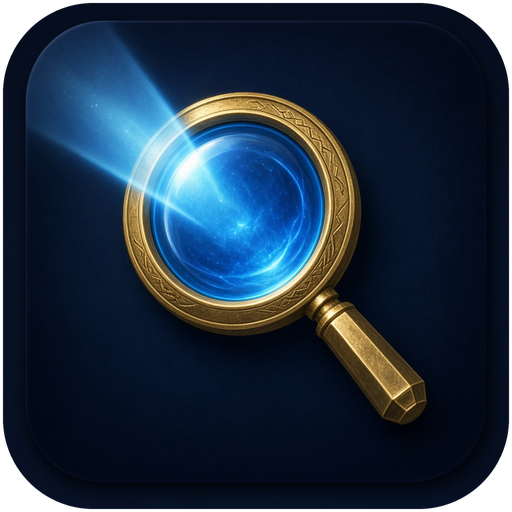

<p align="center"></p>

# Searchlight v0.1.2

**Spotlight for Azeroth:** Ctrl+Space, type an English NPC, item, object or service,
then Enter/click to waypoint to a nearby known source (reliable vendors preferred).

This repository targets **WoW: Forever**, not an unchanged Classic Era client. Current
upstream Questie has a dedicated Forever TOC with **Interface 16001**. Forever shares
modern UI architecture; the original assumption that it was just Era's addon client
was incorrect. Searchlight uses the common Classic-style API surface with guarded
native-waypoint APIs and optional TomTom. **It has not been run inside WoW yet.**

## Install

Copy **only the top-level `Searchlight/` folder** to the selected game client's
`Interface/AddOns/` directory:

```
<WoW Forever client>/Interface/AddOns/Searchlight/Searchlight.toc
```

Restart the client and enable Searchlight at character select. Do not put the entire
repository inside another `Searchlight` folder. Questie is **not** required. TomTom is
optional; native pins work when the client/map exposes the relevant APIs.

## Use

- **Ctrl+Space** opens/closes the palette. The default is installed only if neither
  Ctrl+Space nor the Searchlight action is already bound; existing bindings are never
  overwritten. Rebind it in the game's key-binding settings under Searchlight.
- `/sl` or `/searchlight` toggles it; `/sl linen cloth` opens with a query.
- Start typing **2+ characters**. Up/Down selects, Enter or a click navigates, Esc closes.
- Try `fishing trainer`, `flight master`, `innkeeper`, `repair`, `mailbox`, `bank`,
  `mining trainer`, `first aid trainer`, `mage trainer`, `linen cloth`, `copper vein`.
- Partial words work: `fishing tra`. Words match at their starts, not fuzzy substrings.
- City/zone names work too: `thunder bluff`, `thunder bl`, or
  `fishing trainer thunder bluff`. An explicit zone constrains locations to that zone.
- Result rows include real item icons, NPC service glyphs and object-type hints.
  A small badge on item icons distinguishes vendor, mob drop, object loot and AH sources.
  Uncached items show a question mark immediately, then update as item data arrives.
- Item results show **Vendor / Mob drop / Object loot / Auction House** and the source's
  English name. Missing physical coordinates trigger a faction-safe AH suggestion.
- `elixir of the mongoose` (item #13452) and original `swiftness potion` (#2459) now
  route to the nearest usable auctioneer when no physical source can be pinned.
  Neutral Booty Bay, Gadgetzan and Everlook auctioneers count for both factions.
- **AH?** means a suggestion, not a checked listing. Tradability, stock and prices are
  unverified. Known quest items are excluded; other soulbound items cannot be identified
  from this dataset. A known physical source elsewhere prevents the AH fallback.
- Same-name items remain separate and show their **item IDs**. Do not assume different
  IDs have the same purchase/use restrictions. Exact names outrank recipe-name matches.
- `/searchlight status` prints client/build, Interface, map/world, database revision
  and waypoint API availability for troubleshooting.

Distances are **straight-line yards**, not walkable routes or travel time. Results on
your current world/continent sort first; other-continent locations are labeled, without
comparing their distances. Within a tier, exact-name matches and documented vendor
variants are preferred; item sources use a reliability-weighted distance rather than
raw nearest-drop distance. Ordinary NPC/object locations still sort by proximity. The
palette refreshes as you move; clicking re-resolves the source with a fresh position, retaining a zone filter.

The addon has **no SavedVariables**. WoW saves the key binding using its own binding
system. Without a SavedVariable first-run flag, an entirely unbound Searchlight action
will get the default again on a later login if Ctrl+Space remains free; assign a different
key or bind Ctrl+Space elsewhere to suppress that behavior.

## Database coverage

Pinned source: Questie/QuestieDB `ae4404b01a45163d3ef05909395b29aafc437bc2`, the current
successor of Questie's Classic database. The full matching source inputs and notices
are vendored, not downloaded in-game.

| Type | Named/searchable records | Records with coordinate data | Valid spawn points |
|---|---:|---:|---:|
| NPCs | 13,426 | 8,509 | 86,943 |
| Items | 21,442 | 7,563 via physical sources | — |
| Objects | 6,965 | 4,783 | 51,206 |
| **Total** | **41,833** | | **138,149** |

138,148 points have an AreaID -> UiMapID mapping; one object's point is unmapped.
9,995 items have known physical source links; 7,563 have a source with usable coordinate
data. The compiled graph has 621,266 source relationships. This is **not a complete
all-item/all-NPC game catalog**. Missing physical item locations may instead show an
unverified AH suggestion; other missing locations are explicitly unavailable.
2,482 instance-presence sentinels and 81 unnamed records were excluded. 383 encountered
source references do not resolve to named shipped entities. See
`Searchlight/Data/coverage.json` for exact machine-readable counts and file sizes.

### Forever-specific content: integrated, but incomplete

QuestieDB already has dedicated coordinate-adjusted Forever raw data, inherited
corrections, generated new-content providers, generated client traces, authored Static
corrections, and reviewed new-zone mappings. These are integrated in their documented
order; **no Wowhead scraping was performed**.

| New zone | NPC records with spawns | Object records with spawns | Source spawn pairs |
|---|---:|---:|---:|
| Mount Hyjal | 90 | 6 | 154 |
| Riverglades | 197 | 13 | 445 |
| Zephras Isle | 314 | 44 | 7,678 |
| Shen'dralas | 28 | 0 | 60 |

These are partial community-data coverage counts, **not in-game accuracy certification**.
New dungeon entrances and many sources/objects remain unknown. QuestieDB's own audits
warn about inherited content, held-back relationships and pending live spatial checks.
New race/class availability, phase/quest state, seasonal policy and Dynamic corrections
are not evaluated. See [data provenance](THIRD_PARTY_NOTICES.md) and
[overlay/refresh instructions](docs/OVERLAYS.md) before adding data.

## Speed and implementation

- Build-time English word-start prefix/token index; keystrokes look up posting strings
  and intersect them, rather than scanning all names.
- 55,791 prefixes; deduplicated, delta-coded postings and shared spawn/source string
  pools. Metadata has a bounded 512-record decode cache. No external Lua libraries.
- Top 10 is selected **after** source-quality/distance ranking. Map coordinates are projected
  into world space via `C_Map.GetWorldPosFromMapPos`; cached affine map bases avoid
  calling the API per spawn. No cross-zone percentage-distance comparisons.
- Typing is throttled by 40 ms. Broad searches run incrementally with a roughly 4 ms
  cooperative CPU budget per frame; GC/single operations can exceed that target.
- About **16.8 MiB retained** for the database/modules and **17.3 MiB warm** including
  palette/cache in standalone Lua 5.1 tests. This is an estimate, not in-client addon
  memory accounting. No addon SavedVariables. Generated data is approximately **9.0 MiB
  on disk**; the complete installed addon is approximately **9.2 MiB**.
- The data is eagerly loaded, not a separate load-on-demand addon. At this size, retaining
  a single install folder and avoiding first-open disk/parsing stalls is the v1 tradeoff.
  Deduplicated strings reduce memory instead of materializing all spawns/index postings
  as nested Lua number tables. A future larger database can split into LoD flavor packs.

## Build and validate

Requires Python 3 and **Lua 5.1 / luac 5.1**. No Python packages are required.

```sh
python3 tools/build_db.py --lua lua5.1
python3 tools/check.py --lua lua5.1 --luac luac5.1
```

`tools/build_db.py --fetch` can recover missing **pinned** public source files, verifying
SHA-256 against `tools/sources.lock.json`. Default builds are offline and deterministic.
The Lua source adapter runs in a capability-limited environment with no `io`, `os`,
`require` or network access. `--flavor era` is a developer rebuild option that uses the
Era data/Interface 11509; the checked-in build and main test harness are for Forever.

Tests cover actual database queries, every requested profession/class role, world-space
and cross-continent ordering, geographic scoping, vendor/mob/object reliability, potion
AH fallback, faction/neutral auctioneers, moved-player re-resolution, unavailable positions/instances, native+TomTom waypoints, safe bindings,
and palette keyboard/slash behavior using stubbed WoW APIs. See
[validation results](docs/VALIDATION.md). **Follow the [in-game checklist](docs/IN_GAME_TESTING.md)**
for actual client validation; offline tests cannot prove UI appearance or live map accuracy.

## Item source policy and crafting data

Known opposite-faction vendors are filtered. Within the same continent, a vendor can
beat a closer low-chance drop; an extremely close drop can still win over a very distant
vendor. Questie rates are shipped for the subset with usable percentage data; missing
rates use a conservative heuristic, not a fabricated percentage. Rare/boss/elite NPC
ranks are penalized. **Vendor stock, limited supply and purchase/use restrictions are
not known.** Exact-name vendor variants rank ahead of same-name AH suggestions.

Kyleen's Greater Healing Potion is **#223914**; the original potion is **#1710** and has
different vendor links. We preserve that distinction instead of incorrectly attaching
Kyleen to #1710. Check the displayed ID and actual in-game restrictions before traveling.

The pinned sources contain **no usable item -> creating spell/profession/required-skill
mapping**. `Crafted: Alchemy (skill N)` and alternative crafting-trainer routing are
therefore **not implemented**; no profession/skill is guessed from a potion's name.
See [the detailed policy](docs/SOURCE_POLICY.md) and [validation examples](docs/VALIDATION.md).

## Repository layout

```
Searchlight/              Installable addon folder
  Searchlight.toc         Forever Interface 16001
  Bindings.xml            Searchlight toggle action
  Init.lua, Core.lua      Namespace, slash commands, safe default key binding
  Search.lua              Compact-row decoding, indexed queries, nearest-source ranking
  Navigation.lua          Map projections and native/TomTom waypoints
  Icons.lua               Legacy role glyphs and guarded async item icon lookups
  UI.lua                  Search palette and cooperative live updates
  Media/Icon.tga          Original 128px gold/arcane-blue addon logo
  Data/                   Generated Lua database/index + coverage.json
  LICENSE                 GPLv3 text
  THIRD_PARTY_NOTICES.md   Attribution and historical licensing caveat
vendor/QuestieDB/          Exact corresponding upstream data sources and original notices
tools/                    Python builder/check runner, sandboxed Lua adapter, source lock
  overlay.example.json    Empty, provenance-required overlay template
tests/                    Offline Lua harness and Python compiler/integrity tests
docs/                     Validation, icon manifest, 512px logo.png and client/data notes
.github/workflows/        release.yml: package and publish on v* tags
.pkgmeta                  Packager layout (zip contains only Searchlight/)
CHANGELOG.md              Release notes uploaded with each release
LICENSE                   GPLv3 text
```

## Logo and icon assets

The original gold magnifier / arcane-blue search beam appears in the addon list and
palette header. Preview: [512px PNG](docs/logo.png). The shipped `Media/Icon.tga` is
128x128, uncompressed 32-bit BGRA with 8-bit alpha and bottom-left origin. To regenerate
it from the canonical PNG, run `python3 tools/build_media.py` (this optional artwork tool
requires Pillow; normal DB builds/tests still use only Python's standard library).

NPC/object/source icons reference legacy built-in game textures; Blizzard artwork is
not bundled. Object classification uses conservative English-name hints because the
compact database has no game-object type; unknown new objects keep a generic glyph.
See [the complete texture manifest and confidence notes](docs/ICONS.md). All icon APIs
are optional/guarded, missing textures fall back to a question mark when detectable,
and only visible item rows request data. No SavedVariables/icon catalog is added.

## Releasing

Tagging `v*` publishes to CurseForge (optionally Wago) and GitHub Releases through
BigWigsMods/packager. See [docs/RELEASING.md](docs/RELEASING.md) and [CHANGELOG.md](CHANGELOG.md).

## Known limitations

- English names/ASCII tokenization only. Not a fuzzy search, quest tracker, drop-rate
  optimizer, route planner, live-stock detector, or phase/quest-state-aware database.
  Rate percentages are historical upstream observations, not live Forever drop guarantees.
- Known opposite-faction services/vendors are filtered. Unknown faction, class/race,
  reputation, limited stock, season and quest restrictions can still affect usability.
- Instance-only presence markers are not turned into fictional coordinates or guessed
  dungeon entrances. Item results may instead suggest an AH; no usable AH/physical
  coordinates means no waypoint.
- Without player/world position, distances are hidden and the nearest spawn cannot be
  guaranteed; known locations can still be viewed/pinned. Same-map fallbacks are labeled.
- Spawn coordinates are quantized to 0.01 map-percent. Moving NPCs/resources represent
  sampled possible locations, not current availability. Map changes can invalidate old data.
- Native user-waypoint/super-tracking support differs by client/map. TomTom is optional
  and is attempted in addition to native waypoints. API failures produce a readable message.
- Forever Interface 16001 is corroborated by Questie's live Forever TOC, not by launching
  the game here. Retest after a patch; do not silently reuse Era coordinates on Forever.

## Support

Searchlight is free. If you'd like to support development, you can [buy me a coffee](https://buymeacoffee.com/dunyakilavuz).

## License

GPL version 3 for Searchlight, with included source and attribution. **Upstream expressly
permits GPLv3 copying but retains a caveat about incomplete historical contributor
consent.** See [THIRD_PARTY_NOTICES.md](THIRD_PARTY_NOTICES.md) and the unmodified
`vendor/QuestieDB/LICENSE.md`. Do not assume every historical contribution has been
independently cleared for public redistribution.
